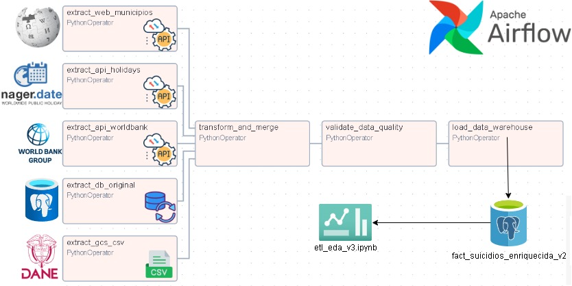

# Pipeline ETL Orquestado: Análisis de Presuntos Suicidios en Colombia y el Valle del Cauca (2015–2024) — Segunda Entrega

Este proyecto evoluciona el modelo dimensional en estrella en PostgreSQL y el pipeline inicial en Python de la primera entrega hacia una arquitectura de ingeniería de datos automatizada, validada y orquestada. Incorpora Apache Airflow, Great Expectations, consumo resiliente de APIs públicas, Web Scraping, Google Cloud Storage, contenedores Docker y un patrón de Cuarentena de Datos (Dead Letter Queue).

---

## 1. Objetivos y Justificación Analítica (ODS 3.4)

El proyecto se enmarca en el **Objetivo de Desarrollo Sostenible 3 (Salud y Bienestar - Meta 3.4)** para identificar perfiles de vulnerabilidad y patrones territoriales en salud mental.

A partir del análisis exploratorio inicial —donde se identificó que Cali concentra el mayor volumen absoluto de casos en el Valle del Cauca y que hubo un repunte sostenido entre 2021 y 2023— esta Segunda Entrega integra fuentes demográficas, socioeconómicas y estacionales para responder a las siguientes preguntas de negocio:
1. **Incidencia per cápita municipal:** ¿Qué municipios del Valle del Cauca presentan mayor incidencia real al transformar los conteos absolutos en tasas por cada 100.000 habitantes y cruzarlos con su altitud y superficie?
2. **Correlación macroeconómica:** ¿Existe relación entre la evolución de la tasa de desempleo anual en Colombia y la curva de presuntos suicidios entre 2015 y 2024?
3. **Estacionalidad y ventanas de vulnerabilidad:** ¿Se incrementan los casos durante días festivos o fechas especiales del calendario colombiano?

---

## 2. Fuentes de Datos Integradas

El pipeline extrae, estandariza y consolida cinco fuentes de datos heterogéneas:

| Fuente de Datos | Tipo / Origen | Integración y Valor Analítico |
| :--- | :--- | :--- |
| **1. Presuntos Suicidios** | PostgreSQL en Docker | Tabla de hechos base (`fact_presuntos_suicidios`) y dimensiones originales (`dim_geografia`, `dim_tiempo`) alojadas en el contenedor `etl_entrega_2` para el periodo 2015-2024. |
| **2. Proyecciones DANE** | CSV en Google Cloud Storage | Proyecciones poblacionales descargadas dinámicamente desde el bucket `gs://ws2-etl-bucket/`. Se unen por municipio y año para calcular tasas por 100.000 habitantes. |
| **3. Tasa de Desempleo (Banco Mundial)** | API Pública REST | Serie histórica anual extraída de forma resiliente (`requests.Session`, `Retry`, backoff exponencial) para medir el impacto macroeconómico. |
| **4. Días Festivos (Nager.Date)** | API Pública REST | Extracción iterativa de festivos en Colombia (2015–2024) para enriquecer la dimensión de tiempo y evaluar picos de riesgo estacionales. |
| **5. Municipios del Valle** | Web Scraping (Wikipedia) | Extracción de tablas HTML estáticas con `BeautifulSoup` y Pandas para integrar superficie, altitud y población de los municipios analizados. |

---

## 3. Arquitectura e Infraestructura (Google Cloud Platform)

El entorno de producción está desplegado en una máquina virtual de **Google Cloud Platform** (Instancia: `sgrd-yumbo-vm`) bajo un esquema aislado y modularizado:

* **Directorio de Trabajo:** `/home/alexelgordo/etl_entrega_ii`
* **Data Warehouse (PostgreSQL):** Contenedor Docker independiente (`etl_entrega_2`) expuesto en el puerto host `5433`, alojando la base de datos `suicidios_colombia`.
* **Orquestador (Apache Airflow 2.10.2):** Stack orquestado con `docker-compose` que incluye `airflow-webserver` (puerto `8083`), `scheduler` y una base de metadatos propia.
* **Data Lake / Storage:** Uso de Google Cloud Storage (`ws2-etl-bucket`) para el acopio de archivos planos CSV y copias de seguridad de la base de datos.

---

## 4. Fases del Pipeline (DAG: `etl_suicidios_valle_v2`)

El flujo de trabajo se ejecuta diariamente (`@daily`) mediante tareas programadas en Airflow:



1. **Extract (Extracción Paralela):** Tareas independientes consumen las APIs, scrapean la web, descargan archivos del bucket GCS y consultan el Data Warehouse relacional, almacenando los resultados intermedios en una capa *Staging* local (`/opt/airflow/data`).
2. **Transform & Merge:** Pandas se encarga de limpiar nulos, aplicar *Entity Resolution* (normalización de textos y cruces por códigos DANE o nombres de municipios), eliminar columnas redundantes (superposición de sufijos `_x`, `_y`) y fusionar las 5 fuentes en un único dataset maestro.
3. **Validate (Data Quality):** Intervención de *Great Expectations* para auditar el dataset maestro contra un contrato de datos estricto.
4. **Load (Carga Condicional):** Los datos estructurados se inyectan en el Data Warehouse utilizando *SQLAlchemy*, separando la carga según la calidad del dato.

---

## 5. Gobierno de Datos: Calidad y Patrón de Cuarentena

Para proteger la integridad del Data Warehouse y garantizar la confiabilidad de los dashboards de Business Intelligence, el pipeline implementa un **Contrato de Datos** con Great Expectations bajo un patrón de **Cuarentena (Dead Letter Queue)**:

* **Reglas Deterministas:** Se valida que los años estén en el rango 2015-2025, que la tasa de desempleo esté entre 0% y 50%, y que llaves críticas como municipio y sexo no contengan valores nulos.
* **Bifurcación de Datos:** En lugar de detener el pipeline ante un error (Fail-Stop), el script aísla los registros anómalos.
  * **Datos Limpios:** Los registros que cumplen el 100% de las reglas se cargan en la tabla analítica principal: `public.fact_suicidios_enriquecida_v2`.
  * **Datos en Cuarentena:** Los registros que fallan se desvían automáticamente a la tabla `public.cuarentena_suicidios`. Esto permite que el pipeline entregue valor continuo al negocio mientras el equipo de Ingeniería de Datos audita las anomalías posteriormente.

---

## 6. Estructura del Repositorio

El proyecto mantiene una estructura modularizada en Python:

```text
etl_entrega_ii/
├── backup/
│   └── suicidios_completo.sql    # Dump original de la BD PostgreSQL (Estructura y Datos)
├── .env                          # Variables de conexión (DB Docker y Bucket GCS)
├── .gitignore                    # Archivos excluidos (logs, datos temporales, entornos)
├── Dockerfile                    # Imagen personalizada de Apache Airflow 2.10.2
├── docker-compose.yml            # Orquestación de infraestructura Docker
├── requirements.txt              # Dependencias (pandas, great_expectations, bs4, etc.)
├── README.md                     # Documentación técnica
├── dags/
│   └── etl_suicidios_dag.py      # DAG principal de orquestación
├── scripts/
│   ├── extract_sources.py        # Módulos de ingesta paralela
│   ├── transform_merge.py        # Limpieza y consolidación tabular
│   ├── validate_ge.py            # Contrato de datos y enrutamiento a cuarentena
│   └── load_dw.py                # Carga al esquema public de PostgreSQL
└── notebooks/
    └── 03_etl_eda_v2.ipynb       # Análisis exploratorio (Data Profiling) de fuentes
```

Nota: Asegúrese de consultar la tabla fact_suicidios_enriquecida_v2 para la construcción de reportes, ya que esta contiene exclusivamente los registros que superaron el contrato de datos.

## 7. Guía de Replicación en Entorno Local

Dado que el servidor de Google Cloud puede no estar disponible indefinidamente, este proyecto está paquetizado para poder ejecutarse en cualquier entorno local (Mac, Windows, Linux) utilizando Docker.

Siga estos pasos para levantar el proyecto desde cero:

#### Paso 1: Clonar el repositorio y configurar variables de entorno
```bash
git clone https://github.com/JheffreyUrbano/etl_entrega_2
cd TU_REPOSITORIO_LOCAL

cat << 'EOF' > .env
DW_HOST=host.docker.internal
DW_PORT=5433
DW_USER=airflow
DW_PASSWORD=airflow
DW_DB=suicidios_colombia
GCS_BUCKET_NAME=ws2-etl-bucket
DANE_CSV_FILENAME=proyecciones_dane.csv
EOF
```

#### Paso 1: Clonar el repositorio y configurar variables de entorno
Para que el script de Airflow pueda acceder a los archivos alojados en el bucket de GCS (ws2-etl-bucket), el entorno local debe autenticarse:

```bash
gcloud auth application-default login
```
(Debe iniciar sesión con una cuenta de Google que tenga permisos de lectura en el proyecto de GCP correspondiente).

#### Paso 3: Inicializar y levantar los contenedores Docker
Ejecute la inicialización de la base de datos interna de Airflow y levante el stack:
```bash
docker-compose up airflow-init
docker-compose up -d --build
```

#### Paso 4: Restaurar la base de datos original
El contenedor de PostgreSQL nace vacío. Para que el pipeline tenga los datos de origen, debes restaurar el archivo de respaldo `suicidios_completo.sql` (ubicado en la carpeta `backup/` de este repositorio) directamente hacia el contenedor local:


- 4.1. Crear la base de datos en el contenedor
```bash
docker exec -it postgres_entrega2 psql -U airflow -c "CREATE DATABASE suicidios_colombia;"
```

- 4.2. Restaurar los datos desde el archivo SQL local
```bash
docker exec -i postgres_entrega2 psql -U airflow -d suicidios_colombia < backup/suicidios_completo.sql
```

Una vez completados estos pasos, puede acceder a la interfaz de Apache Airflow abriendo http://localhost:8083 en su navegador web (Usuario: admin, Contraseña: admin) y ejecutar el DAG etl_suicidios_valle_v2.
